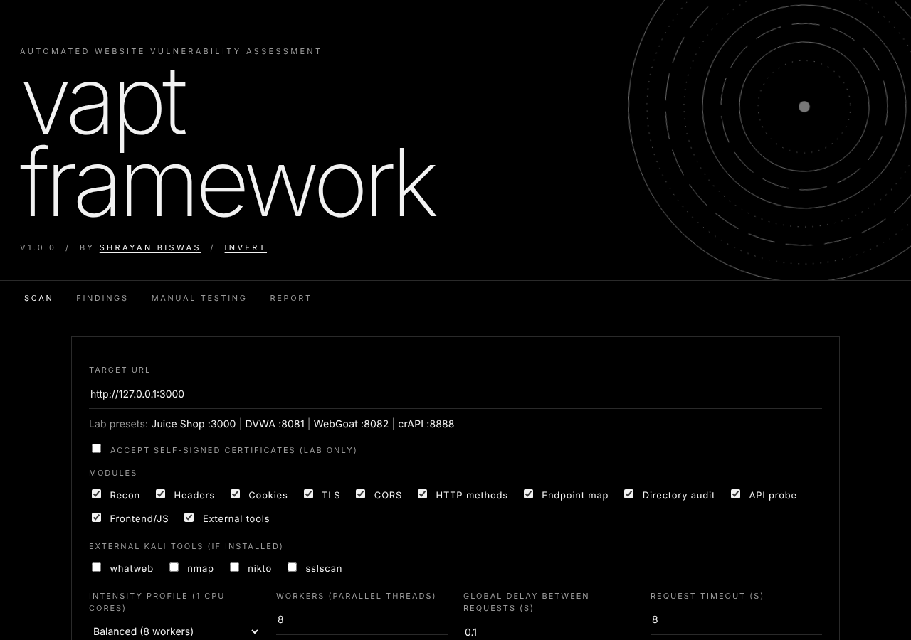
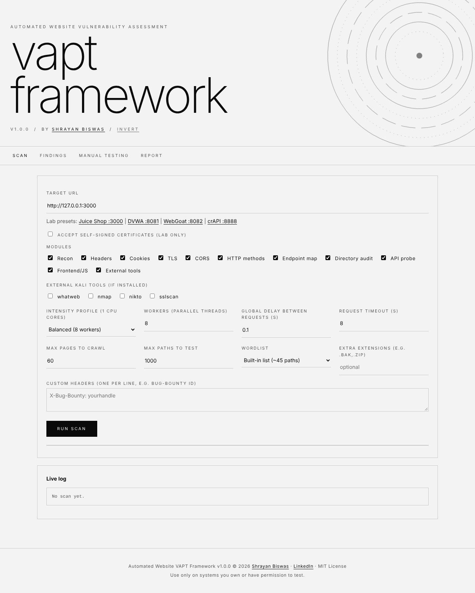

# Automated Website VAPT Framework

A single-file Flask app that automates the **non-intrusive** parts of a 12-phase website vulnerability
assessment workflow: reconnaissance, attack-surface mapping, configuration checks, API and front-end
review, CVSS 3.1 scoring and professional per-target reports.

Built by **[Shrayan Biswas](https://www.linkedin.com/in/shrayan-biswas-a1259225a/)** · [LinkedIn](https://www.linkedin.com/in/shrayan-biswas-a1259225a/) · MIT License

| Dark | Inverted |
|---|---|
|  |  |

The interface is strictly black and white. The rings rotate slowly and speed up while a scan runs
(they stop if your system prefers reduced motion). Click **invert** for a light version.

## Features

- **Automated modules:** recon, security headers, TLS, CORS, HTTP methods, endpoint crawler, directory audit,
  API probe, front-end/JS audit (secrets, source maps, outdated jQuery), cookie audit, plus optional
  `whatweb`, `nmap`, `nikto` and `sslscan`.
- **Multi-threaded** with a shared global rate limiter, a Stop button, a progress bar and a requests/second summary.
- **Per-target everything:** each target has its own findings register, scan history and report.
- **CVSS 3.1** calculator, finding statuses (Open, In Progress, Remediated, Retest Passed, Reopened, Accepted Risk) and notes.
- **Reports** named `<target>_VAPT_Report` in **HTML, PDF and JSON**, regenerated after every scan.
- **Manual testing tab:** checklists for authentication, authorization, injection and validation phases
  (Burp, ZAP, SQLmap) and a form to add confirmed findings with CVSS scoring.

Automated results are indicators, not proof. Items marked CANDIDATE need manual validation.
Injection, auth-bypass, IDOR and exploitation phases are deliberately **not** automated.

## Quick start (Kali / Debian)

```bash
git clone <your-repo-url> Automated-Website-VAPT-Framework
cd Automated-Website-VAPT-Framework
./scripts/setup_kali.sh      # apt: python3-flask, nmap, whatweb, nikto, sslscan, wkhtmltopdf, docker
./scripts/labs.sh start      # Juice Shop :3000, DVWA :8081, WebGoat :8082 (127.0.0.1 only)
./scripts/run.sh             # http://127.0.0.1:5000  (open it in a browser inside the same machine)
```

Without the setup script you only need `python3-flask` (or `pip install -r requirements.txt`) and `python3 vapt_app.py`.
PDF export needs `wkhtmltopdf`; without it you still get HTML and JSON.

## Usage

1. Open the app, enter a target URL (or click a lab preset) and choose an intensity profile:
   **Gentle** (1 worker), **Balanced** (8 workers) or **Lab-max** (cores × 8 workers, no delay).
2. Click **Run scan**. Watch the live log and progress bar; **Stop** ends the scan early.
3. Review the **Findings** tab (pick a target), update statuses, and add manual findings.
4. Open the **Report** tab for HTML / PDF / JSON downloads. Files are also saved automatically.

## Output layout

Everything is written to `~/VAPT-Project/` (override with the `VAPT_HOME` environment variable):

```
reports/target.com/   target.com_VAPT_Report.html / .pdf / .json, findings.json, runs.json
recon/target.com/     endpoint inventory, directory results, front-end audit, raw run data
scans/target.com/     raw nmap / whatweb / nikto / sslscan output
logs/target.com/      scan logs
```

A target on a non-standard port gets the port in its name, e.g. `127.0.0.1_3000_VAPT_Report`.

## Safety and responsible use

- The server binds to **127.0.0.1 only**; only use it from the machine it runs on.
- **Only scan systems you own or have explicit permission to test.** Unauthorized scanning can be illegal
  and can get your IP blocked. You are responsible for how you use this tool.
- Remote (non-private) targets are automatically limited to 4 workers and a 0.25 s delay to avoid overloading
  other people's servers. Redirects to other hosts are never followed.
- Automated checks are limited to GET / HEAD / OPTIONS / TRACE requests, a small rate-limit burst and
  rate-limited path discovery.
- Safe practice targets: OWASP Juice Shop, DVWA, WebGoat, crAPI, `scanme.nmap.org` (light scanning only),
  and other sites that explicitly invite testing.

## Tests

```bash
python3 -m unittest discover -s tests -v
```

The suite is offline and uses only the standard library (CVSS scoring, naming, scope validation,
per-target storage and report generation).

## Repository layout

```
vapt_app.py               the whole application (Flask backend + UI)
scripts/                  setup_kali.sh, labs.sh, run.sh
tests/test_core.py        offline unit tests
docs/VAPT_TRAINING_PLAN.md  the 12-phase training plan this tool automates
.github/workflows/ci.yml  compile + test on every push
```

## License

MIT © 2026 [Shrayan Biswas](https://www.linkedin.com/in/shrayan-biswas-a1259225a/). See [LICENSE](LICENSE).
